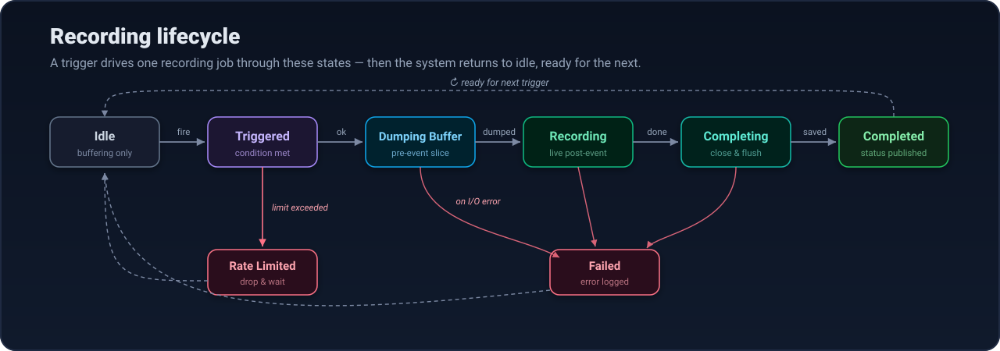
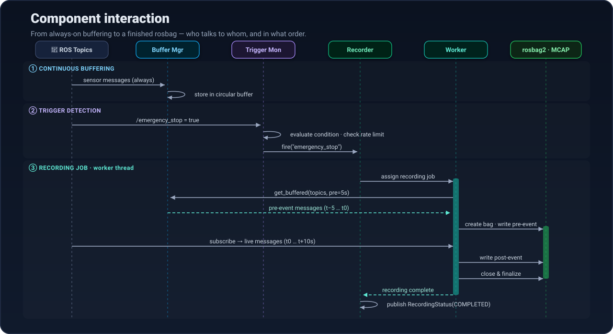
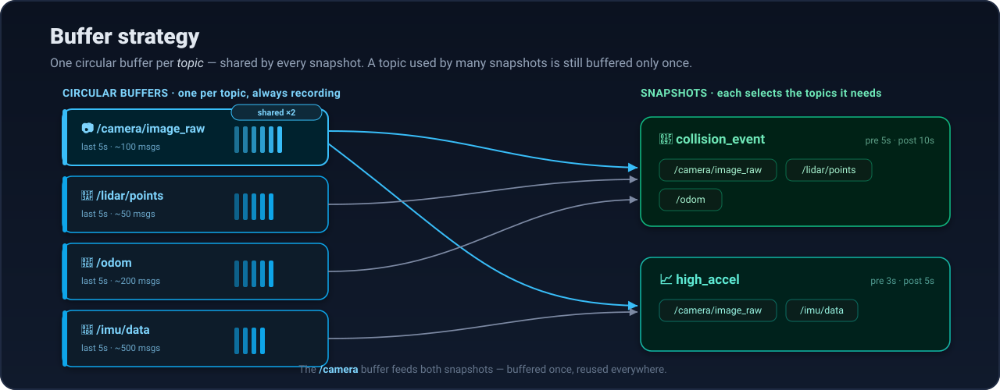

# Architecture

> Internals of ROS Time Machine — components, control flow, and the design decisions behind them.
> For usage, see the [README](README.md).

## Overview

ROS Time Machine is a single ROS 2 node composed of four cooperating components, all driven by one YAML
config. Sensor messages stream continuously into in-memory **circular buffers**; a **trigger monitor**
watches for events; and on a match, the **recorder** fuses the buffered *pre-event* slice with live
*post-event* recording into a single MCAP rosbag.

<p align="center">
  
</p>

| Component | Responsibility |
|-----------|----------------|
| **Config Manager** | Parse & validate the YAML config; expose snapshot definitions at runtime |
| **Buffer Manager** | Maintain a thread-safe circular buffer per topic; serve time-ranged slices on demand |
| **Trigger Monitor** | Subscribe to trigger topics, evaluate conditions, enforce rate limits, fire the recorder |
| **Recorder** | Coordinate recording on a worker pool: dump buffer → record live → write rosbag |

## Recording lifecycle

Each trigger drives one recording job through a small state machine. Rate-limited triggers are dropped
early; I/O errors fail the job cleanly and return the system to idle for the next event.

<p align="center">
  
</p>

## Component interaction

The sequence below traces a single snapshot end-to-end — from always-on buffering, through trigger
detection, to a finalized rosbag. Note that recording runs on a **worker thread**, so the main node
stays responsive to new triggers and concurrent recordings.

<p align="center">
  
</p>

## Buffer strategy

The buffer is keyed by **topic**, not by snapshot. Buffers are allocated once and shared across every
snapshot that references the topic, so a camera feed used by three snapshots is still buffered only once.
On a trigger, the recorder dumps only the topics that the *firing* snapshot needs.

<p align="center">
  
</p>

**Design decisions:**
- **One buffer per topic** (not per snapshot) — avoids duplicating high-bandwidth data across snapshots.
- **Lock-based thread safety** — per-topic mutex guards concurrent producer (subscription) and consumer (dump).
- **Drop-oldest on overflow** — the buffer is a fixed-size window; oldest messages are evicted first.

## Core components

### 1 · Config Manager

Parses and validates YAML configuration files and exposes snapshot definitions at runtime.

```yaml
snapshots:
  - name: "collision_event"
    trigger:
      topic: "/emergency_stop"
      msg_type: "std_msgs/msg/Bool"
      condition: { field: "data", operator: "==", value: 1.0 }
    recording:
      topics: ["/camera/image_raw", "/lidar/points", "/odom"]
      pre_event_duration: 5.0     # seconds
      post_event_duration: 10.0   # seconds
      max_buffer_size: 1000       # MB
    rate_limit:
      max_triggers_per_minute: 5
    output:
      path: "/data/snapshots"
      name_pattern: "{snapshot_name}_{timestamp}"
      format: "mcap"
```

### 2 · Buffer Manager

Maintains a circular buffer per configured topic.

- Thread-safe circular buffer per topic
- Dynamic topic discovery via generic (serialized) subscriptions — no per-type codegen
- Buffer capacity derived from the configured pre-event duration
- Buffer statistics tracking (message counts, drops)

### 3 · Trigger Monitor

Subscribes to trigger topics and decides when to record.

- Condition evaluation engine: `==`, `!=`, `>`, `<`, `>=`, `<=`
- Support for nested message fields (e.g. `linear_acceleration.x`)
- Per-snapshot rate limiting
- Fires the recorder on a match

### 4 · Recorder

Turns time-addressed triggers into clips, on a worker thread pool.

- Every trigger (rule, service, `EventTrigger`, kept pin) becomes an `EventRequest` with a
  window `[start, end]` in robot ROS time
- A **trigger queue** merges overlapping windows of one profile and enforces per-profile rate
  limits and a global clips-per-hour budget
- A dispatcher releases a clip once robot time passes `end + write_settle_time`. There's no
  wall-clock sleep, so sim time and bag replay work
- Pending and in-flight clips, and **pins**, act as an eviction guard on the buffers: protected
  messages move to a bounded side store instead of being dropped
- MCAP or sqlite3 rosbag2 output plus an `event.json` sidecar

Per clip:
1. Wait until robot time has passed the window end
2. Read every profile topic's messages in `[start, end]` from the buffers (noting whether each
   buffer still reached back to `start`)
3. Merge by timestamp with a stable topic tie-break and write the bag
4. Write `event.json`, release the protection, publish `~/recording_status`

The queue, pin manager and sidecar writer are ROS-free (`rtm_core`) and unit-tested on their own.

### 5 · Service & topic interface

Runtime control and monitoring (`RosInterface`).

- **Subscriptions:** `/time_machine/event_trigger` (`EventTrigger`)
- **Services:** `~/trigger_snapshot`, `~/pin_range`, `~/release_pin`, `~/list_snapshots`, `~/get_status`
- **Topics:** `~/recording_status` (per finished clip), `~/buffer_stats` (per topic, incl. pins)

### 6 · VLM watcher (`rtm_watcher`, Python)

A separate node, so it can run on the robot, a LAN box, or next to a GPU.

- Samples cameras at `sample_hz` in robot time, keeps the last N frames per camera
- Prompts an OpenAI-compatible VLM with numbered frames, a state summary and the watch list
- Validates the JSON answer; maps `frame_index` back to that frame's timestamp
- Confidence threshold → per-label cooldown → sampling → `EventTrigger`
- Cascade: subscribes to scorer topics, calibrates a conformal threshold, pins spikes via
  `~/pin_range`, judges the pinned frames, answers with `~/release_pin`

See [docs/SEMANTIC_TRIGGERS.md](docs/SEMANTIC_TRIGGERS.md) for configuration and behavior.

## Technology stack

**ROS 2**
- **Distribution:** Jazzy Jalisco (Ubuntu 24.04)
- **Build system:** colcon with `ament_cmake`
- **Language:** C++17 (core) · Python (REST bridge, VLM watcher)
- **Key dependencies:** `rclcpp`, `rosbag2_cpp`, `std_msgs`, `sensor_msgs`, `yaml-cpp`

**Testing**
- GTest for C++ unit tests
- `launch_testing` for ROS 2 integration tests

## Performance considerations

**Memory**
- Buffer size is a function of topic bandwidth × pre-event duration.
  *Example:* a 10 Hz image topic at ~1 MB/msg with a 5 s buffer ≈ 50 MB.
- Configurable memory limits with drop-oldest degradation.

**Threading**
- Buffer updates guarded by per-topic mutex locks.
- Recording handled by a configurable worker pool (default: 4) — trigger handling stays non-blocking.
- Async I/O for disk writes.

**I/O**
- Worker pool sized to available I/O capacity.
- Buffered writes minimize syscalls; MCAP format for efficient storage.
- Queue management prevents memory overflow under sustained triggering.
