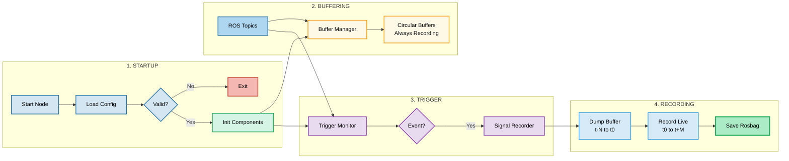
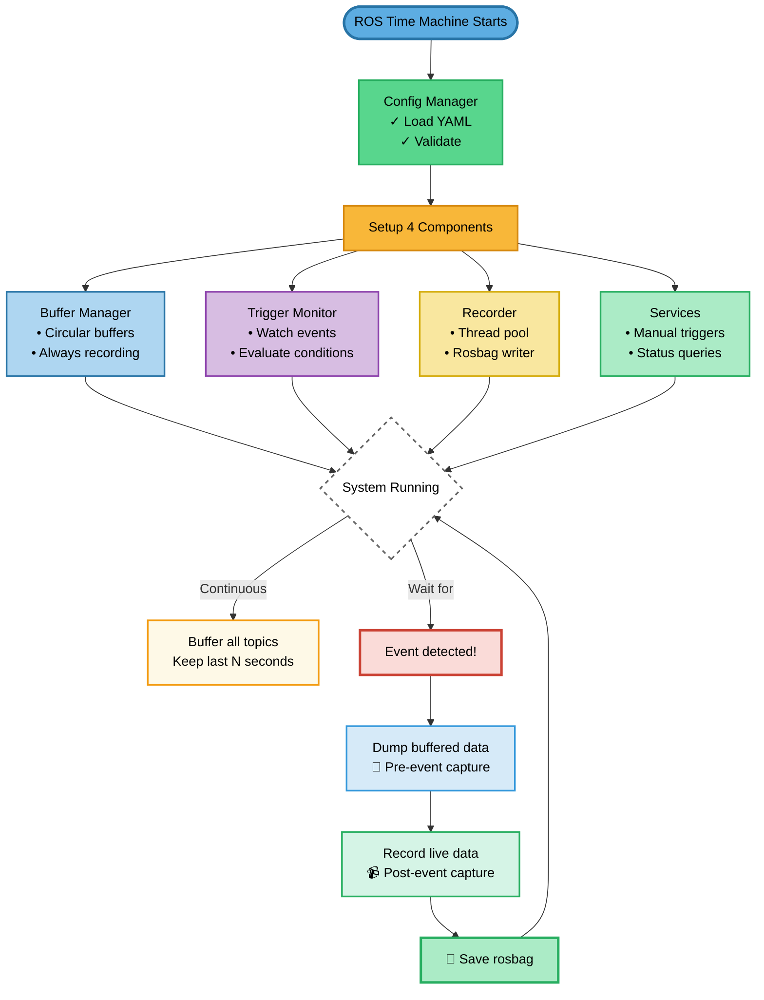
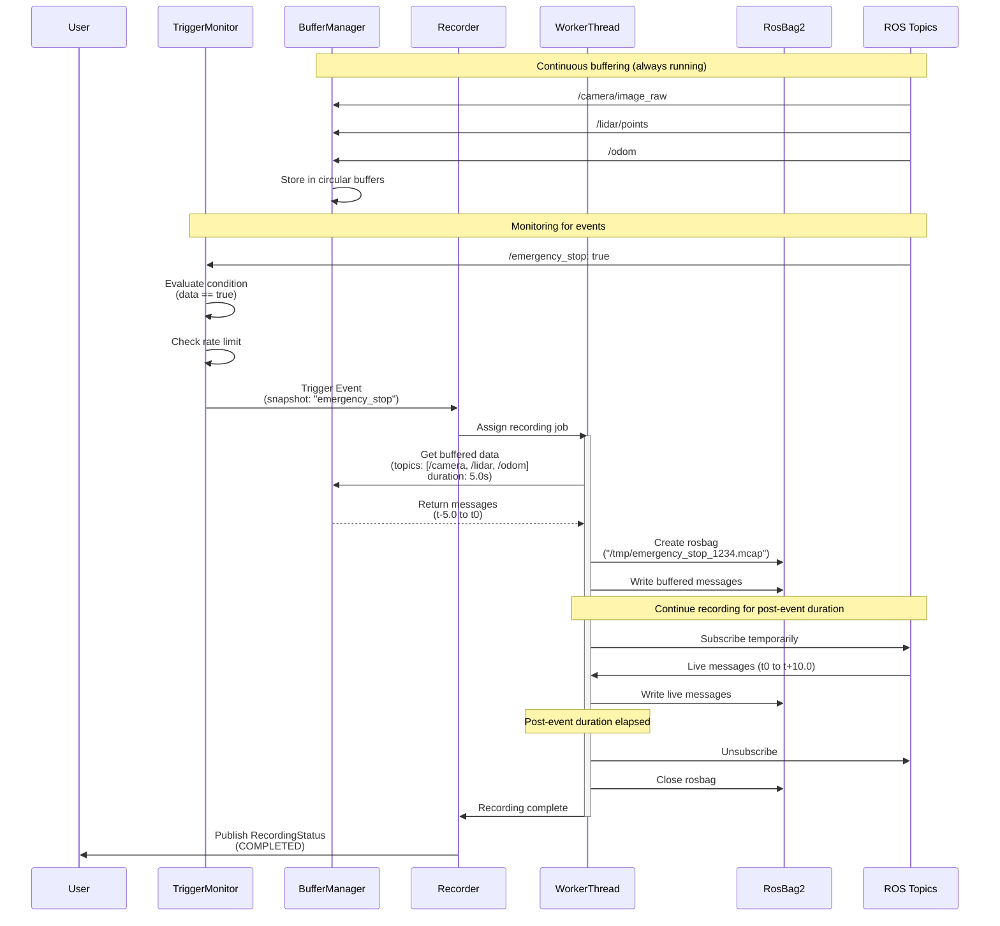
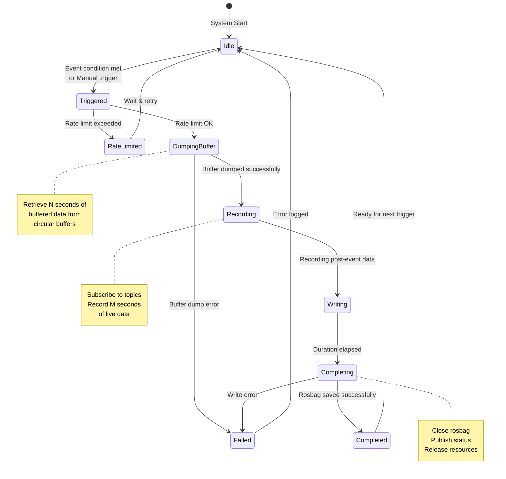
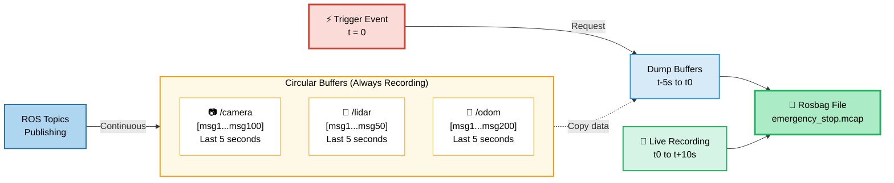

# ROS Time Machine - Architecture

## Overview

Event-triggered recording system for ROS2 that captures sensor data snapshots with pre-event buffering and post-event recording capabilities.

## System Flow

### High-Level Data Flow



### Simplified Flow Diagram



### Component Interaction Sequence



### Recording Lifecycle State Machine



### Buffer Management Strategy



**Key Concept:** One buffer per topic, shared by all snapshots. When triggered, dump only the topics needed for that specific snapshot.

## Core Components

### 1. Config Manager

**Responsibility:** Parse and validate YAML configuration files

**Features:**
- YAML configuration parsing
- Snapshot configuration validation
- Runtime configuration access

**Example Configuration:**
```yaml
snapshots:
  - name: "collision_event"
    trigger:
      topic: "/emergency_stop"
      msg_type: "std_msgs/msg/Bool"
      condition:
        field: "data"
        operator: "=="
        value: 1.0
    recording:
      topics:
        - "/camera/image_raw"
        - "/lidar/points"
        - "/odom"
      pre_event_duration: 5.0  # seconds
      post_event_duration: 10.0  # seconds
      max_buffer_size: 1000  # MB
    rate_limit:
      max_triggers_per_minute: 5
    output:
      path: "/data/snapshots"
      name_pattern: "{snapshot_name}_{timestamp}"
      format: "mcap"
```

### 2. Buffer Manager

**Responsibility:** Maintain circular buffers for configured topics

**Features:**
- Thread-safe circular buffer per topic
- Dynamic topic discovery
- Configurable buffer size based on duration
- Memory-efficient message storage
- Buffer statistics tracking

**Design Decisions:**
- Separate buffer per topic (not per snapshot) to avoid duplication
- Lock-based thread safety for concurrent access
- Drop oldest messages on overflow

### 3. Trigger Monitor

**Responsibility:** Monitor topics and evaluate trigger conditions

**Features:**
- Dynamic topic subscription
- Condition evaluation engine (==, >, <, >=, <=, !=)
- Support for nested message fields
- Rate limiting per snapshot
- Trigger event signaling

### 4. Recorder

**Responsibility:** Coordinate recording on trigger events

**Features:**
- Multi-threaded recording with worker pool
- Buffer dump coordination
- Post-event live recording
- MCAP rosbag2 format output
- Multiple simultaneous recordings support

**Threading Strategy:**
- Main thread: Listen for trigger events
- Worker thread pool: Handle individual recordings
- Each recording job:
  1. Dump buffer to rosbag
  2. Subscribe to topics for post-event duration
  3. Write to rosbag2 file
  4. Cleanup and publish status

### 5. Service Interface

**Responsibility:** Runtime control and monitoring

**Services:**
- Manual snapshot triggering
- System status queries
- Configuration listing

**Topics:**
- Recording status events
- Buffer statistics

## Component Composition

```
┌─────────────────────────────────────────────────────────┐
│                   ROS Time Machine Node                  │
├─────────────────────────────────────────────────────────┤
│  ┌──────────────┐  ┌──────────────┐  ┌──────────────┐  │
│  │   Config     │  │   Trigger    │  │   Buffer     │  │
│  │   Manager    │──│   Monitor    │──│   Manager    │  │
│  └──────────────┘  └──────────────┘  └──────────────┘  │
│         │                  │                  │          │
│         └──────────────────┴──────────────────┘          │
│                            │                             │
│                   ┌──────────────┐                       │
│                   │   Recorder   │                       │
│                   │   Component  │                       │
│                   └──────────────┘                       │
│                            │                             │
│                   ┌──────────────┐                       │
│                   │   Service    │                       │
│                   │   Interface  │                       │
│                   └──────────────┘                       │
└─────────────────────────────────────────────────────────┘
```

## Technology Stack

### ROS2 Dependencies
- **ROS2 Distribution:** Humble Hawksbill (LTS) or Jazzy Jalisco
- **Build System:** colcon with ament_cmake
- **Language:** C++ (core components)
- **Dependencies:**
  - rclcpp (ROS2 C++ client library)
  - rosbag2_cpp (recording)
  - std_msgs, sensor_msgs (message types)
  - yaml-cpp (configuration parsing)

### Testing
- GTest for C++ unit tests
- launch_testing for ROS2 integration tests

## Performance Considerations

### Memory Management
- Buffer sizes calculated from topic bandwidth and pre-event duration
- Example: 10Hz image topic @ 1MB/msg, 5s buffer = 50MB
- Configurable memory limits with graceful degradation

### Threading Strategy
- Buffer updates: Per-topic mutex locks
- Recording threads: Configurable worker pool (default: 4)
- Non-blocking trigger handling
- Async I/O for disk writes

### I/O Optimization
- Thread pool sized for available I/O capacity
- Buffered writes to minimize syscalls
- MCAP format for efficient storage
- Queue management to prevent memory overflow
