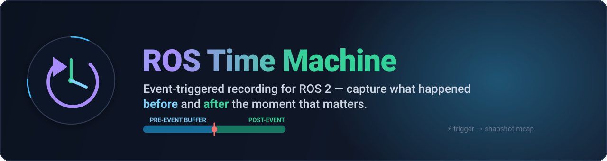
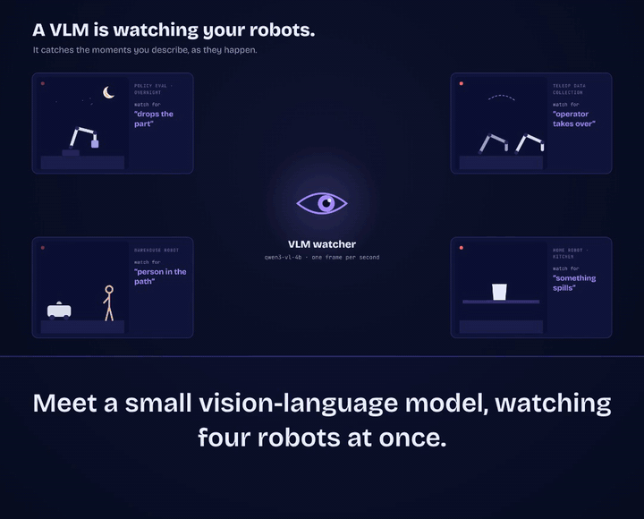
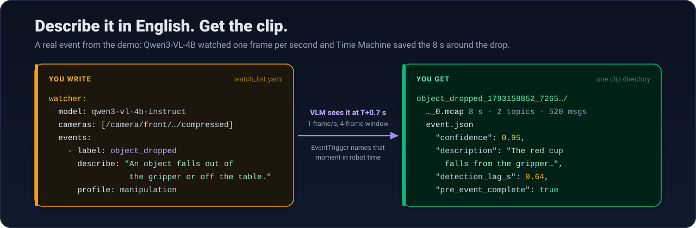
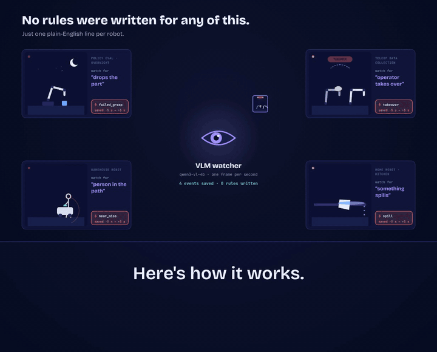
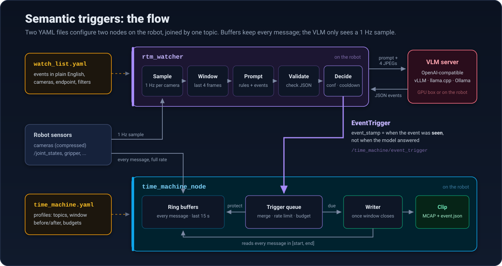
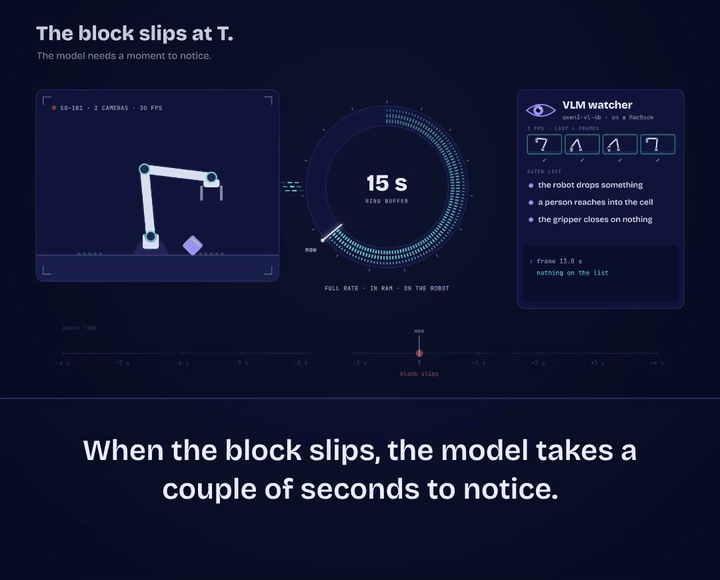
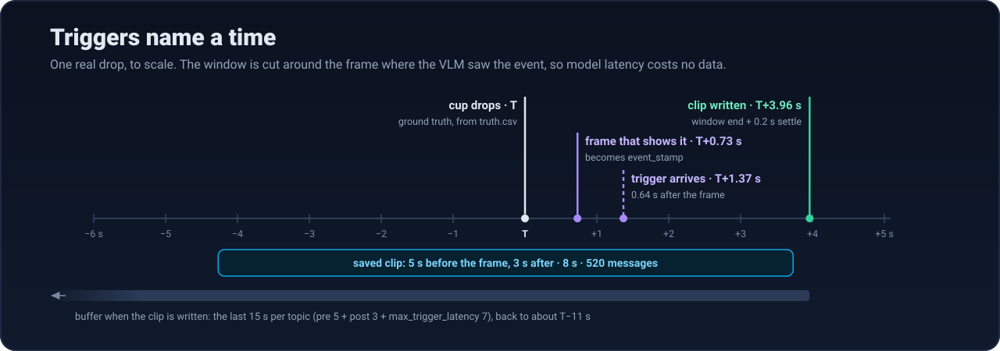
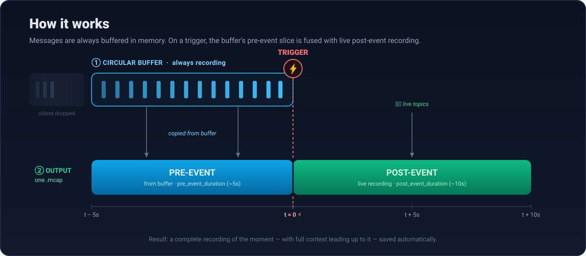
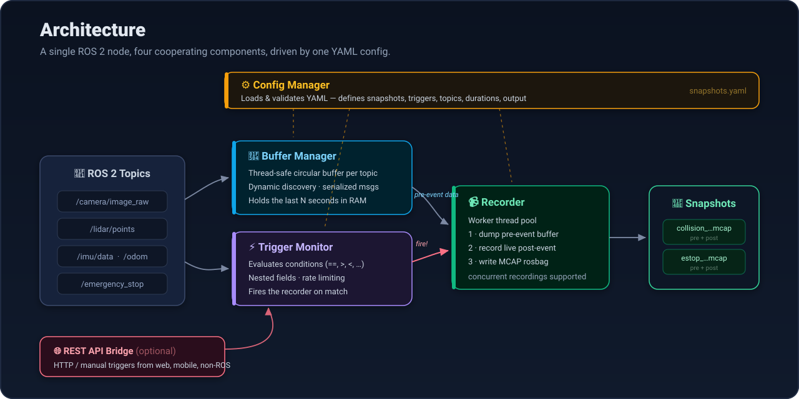

<p align="center">
  
</p>

<p align="center">
  <a href="LICENSE"></a>
  
  
  
  
  <a href="#new-in-v2-semantic-triggers"></a>
</p>

<p align="center">
  <b>A dashcam for your robot.</b> Continuously buffer recent sensor data, and when something
  important happens, automatically save a rosbag with the moments <i>before</i> and <i>after</i> the event.
  <br><b>New in v2:</b> describe those moments in plain English, and a vision-language model decides when to save.
</p>

---

## Why?

When a robot does something unexpected — a collision, an emergency stop, a weird sensor reading — the
data you *really* want is the few seconds **leading up to it**. But you can't record everything forever.

ROS Time Machine keeps a rolling, in-memory buffer of the last *N* seconds for each topic. The instant a
trigger fires, it stitches that **pre-event** buffer together with **live post-event** recording into a
single MCAP rosbag — capturing the full story of the moment, automatically.

## New in v2: semantic triggers

Describe the moments you care about in plain English. A vision-language model (VLM) watches a
1 frame-per-second copy of your cameras, and when it sees one of your events, Time Machine saves
the full-rate, multi-topic clip around the moment it **happened**, not the moment the model
answered. Every clip explains itself in an `event.json`.

<p align="center">
  
</p>

<p align="center">
  
</p>

### Try it in two minutes, no GPU needed

```bash
colcon build && source install/setup.bash
ros2 launch rtm_watcher demo.launch.py          # fake camera drops a cup every 20 s; a scripted VLM spots it

# in another terminal, after about 15 s
ros2 run rtm_watcher review list /tmp/ros_time_machine/demo
```

### Your own robot: first clip in a minute

With your robot running (or a bag: `ros2 bag play <bag> --loop`):

```bash
ros2 run rtm_watcher quickstart              # finds your cameras and joint states; Enter saves the last 10 s
ros2 run rtm_watcher quickstart --vlm fake   # adds the VLM watcher, with a scripted model
```

`quickstart` writes `rtm_quickstart/time_machine.yaml` and `rtm_quickstart/watch_list.yaml`
for your topics, and never overwrites them once they exist. Describe your own events in the
watch list, then point it at a real model.

**On an NVIDIA GPU** (RTX 40-series, 16 GB), on this machine or one on your LAN:

```bash
cd deploy/vllm && cp .env.example .env && ./serve.sh   # Qwen3-VL-4B FP8 in Docker
ros2 run rtm_watcher quickstart --vlm http://127.0.0.1:8000/v1 --model qwen3-vl-4b-instruct
```

**Without a GPU**, use a hosted model. Camera frames leave your site, so this needs
`--allow-remote`:

```bash
export GEMINI_API_KEY=...
ros2 run rtm_watcher quickstart --allow-remote --api-key-env GEMINI_API_KEY \
    --vlm https://generativelanguage.googleapis.com/v1beta/openai --model <a Flash-Lite model id>
```

**On a Jetson or Apple Silicon**, `ros2 launch rtm_vlm semantic_stack.launch.py` picks a
Qwen3-VL size that fits the device and runs the whole stack. To score any model against
ground truth, run the demo with it: `ros2 launch rtm_watcher demo.launch.py vlm:=external
endpoint:=... model:=...` ([how](docs/TESTING_V2_ON_UBUNTU.md#6-real-vlm-end-to-end)).

### How a trigger becomes a clip

<p align="center">
  
</p>

<p align="center">
  
</p>

The watcher turns your events into a prompt, validates the model's JSON, and filters detections
by confidence and cooldown. What crosses to Time Machine is a single `EventTrigger` message
naming a moment in robot time, so a scorer, an operator or an HTTP call can send one just as
well. **[Follow one event through all ten steps →](docs/SEMANTIC_TRIGGER_FLOW.md)**

### Why the model's latency costs nothing

<p align="center">
  
</p>

<p align="center">
  
</p>

The window is cut around the frame where the model saw the event. A slower model just needs a
longer buffer (`max_trigger_latency`); it never loses the seconds before the event.

### Measured

The demo, 5 minutes and 15 cup drops, with Qwen3-VL-4B FP8 on vLLM on an RTX 4070 Ti SUPER,
scored with `review eval` against ground truth:

| Recall | Detection lag (p50 / p99) | VLM call (warm p50) | Clips with full pre-event data |
|---|---|---|---|
| **15 / 15 drops** | 1.37 s / 1.67 s | 0.23 s | 30 / 31 |

The defaults favour recall: each drop was saved about twice, which costs disk and review time,
not data. See [Testing v2 on Ubuntu](docs/TESTING_V2_ON_UBUNTU.md#6-real-vlm-end-to-end).

### What else v2 adds

| | |
|---|---|
| 🕰️ **Time-addressed triggers** | `EventTrigger` names a moment in robot time; any detector (VLM, scorer, human, REST) can point at the past |
| 👁️ **VLM watcher** | `rtm_watcher` prompts any OpenAI-compatible VLM, validates its JSON, applies confidence, cooldown and sampling |
| 📌 **Pin, then judge** | Cheap scorers pin a window instantly (conformal-calibrated thresholds); the VLM keeps or releases it |
| 🧾 **Self-explaining clips** | Every clip gets an `event.json`: label, caption, confidence, model + prompt version, detection lag, coverage |
| 🧮 **Merging & budgets** | Overlapping triggers become one clip; per-profile rate limits and a clips-per-hour budget |
| ✅ **Review loop** | `review` CLI: mark clips good/bad, precision per label, suggested confidence thresholds |

### Guides

- **[Wiring it into your robot](docs/INTEGRATION_GUIDE.md)**: from your topics to measured clips, step by step
- **[How a trigger becomes a clip](docs/SEMANTIC_TRIGGER_FLOW.md)**: the code path, with a real prompt and `event.json`
- **[Semantic triggers](docs/SEMANTIC_TRIGGERS.md)**: design, configuration, interfaces, cascade, review
- **[Choosing and running a VLM](docs/VLM_BACKENDS.md)** · **[vLLM server on a GPU box](deploy/vllm/README.md)** · **[Testing v2 on Ubuntu](docs/TESTING_V2_ON_UBUNTU.md)**

## How it works

<p align="center">
  
</p>

> **Key idea:** one circular buffer per topic is *always* recording. On a trigger, only the relevant
> slice is extracted and combined with live recording — so you pay memory cost, not disk cost, until it matters.

## Features

| | |
|---|---|
| ⏪ **Pre-event buffering** | Circular buffers continuously hold recent data — capture what happened *before* the trigger |
| ⏺️ **Post-event recording** | Keep recording for a configurable duration *after* the trigger |
| ⚡ **Flexible triggers** | Watch any topic; fire on conditions (`==`, `!=`, `>`, `<`, `>=`, `<=`) over nested message fields |
| 🔍 **Dynamic topic discovery** | Auto-detects and subscribes to topics as they appear — no message-type codegen needed |
| 🚦 **Rate limiting** | Cap recordings per minute/second to avoid runaway disk usage |
| 💾 **MCAP format** | Modern, efficient rosbag2 storage with compression |
| 🧵 **Multi-threaded** | Worker pool handles multiple simultaneous recordings |
| 🌐 **REST API (optional)** | Trigger & list snapshots over HTTP from web apps, mobile, or non-ROS systems |

## Quick start: rule triggers

> **Prerequisites:** ROS 2 Jazzy (Ubuntu 24.04) · a C++17 compiler · rosbag2 with MCAP support

```bash
# 1. Clone & build
git clone https://github.com/arpitg1304/ros-time-machine.git
cd ros-time-machine
colcon build --packages-up-to ros_time_machine
source install/setup.bash

# 2. Launch (uses the bundled example config)
ros2 launch ros_time_machine time_machine.launch.py

# 3. Trigger a snapshot
ros2 topic pub -1 /time_machine/manual_trigger std_msgs/msg/Bool "{data: true}"

# 4. Find your recording
ls /tmp/ros_time_machine/snapshots/
```

To use your own setup, copy and edit the example config:

```bash
cp src/ros_time_machine/config/example_snapshots.yaml my_config.yaml
ros2 launch ros_time_machine time_machine.launch.py config_file:=/path/to/my_config.yaml
```

## Configuration

A snapshot ties together a **trigger**, the **topics** to record, and how much to keep **before/after**:

```yaml
snapshots:
  - name: "emergency_stop"
    trigger:
      topic: "/emergency_stop"
      msg_type: "std_msgs/msg/Bool"
      condition: { field: "data", operator: "==", value: true }
    recording:
      topics: ["/camera/image_raw", "/lidar/points", "/odom"]
      pre_event_duration: 5.0     # seconds kept from the buffer (before)
      post_event_duration: 10.0   # seconds recorded live (after)
    rate_limit:
      max_triggers_per_minute: 3
    output:
      path: "/tmp/ros_time_machine/snapshots"
      name_pattern: "{snapshot_name}_{timestamp}"
      format: "mcap"
```

<details>
<summary><b>📖 Full configuration reference</b></summary>

#### Snapshot
- **name** — unique identifier for this snapshot type
- **description** — human-readable description (optional)

#### `trigger`
- **topic** — ROS topic to monitor
- **msg_type** — full message type, e.g. `std_msgs/msg/Bool`
- **condition** *(optional)* — fire only when this is true
  - **field** — field path in the message (e.g. `data`, `linear_acceleration.x`)
  - **operator** — one of `==`, `!=`, `>`, `<`, `>=`, `<=`
  - **value** — value to compare against

#### `recording`
- **topics** — list of topics to record
- **pre_event_duration** — seconds of buffered data to capture *before* the trigger
- **post_event_duration** — seconds to keep recording *after* the trigger

#### `rate_limit`
- **max_triggers_per_minute** — max triggers allowed per minute
- **max_triggers_per_second** — *(alternative)* max triggers per second
- **window_size** — time window in seconds for rate limiting

#### `output`
- **path** — directory to save recordings
- **name_pattern** — filename pattern (supports `{snapshot_name}` and `{timestamp}`)
- **format** — `mcap` (recommended) or `sqlite3`

</details>

<details>
<summary><b>📋 More example snapshots</b> (high-acceleration detection, multi-camera)</summary>

**High-acceleration detection** — fire when IMU acceleration exceeds a threshold:

```yaml
snapshots:
  - name: "high_accel"
    trigger:
      topic: "/imu/data"
      msg_type: "sensor_msgs/msg/Imu"
      condition: { field: "linear_acceleration.x", operator: ">", value: 5.0 }
    recording:
      topics: ["/camera/image", "/imu/data"]
      pre_event_duration: 3.0
      post_event_duration: 5.0
    rate_limit:
      max_triggers_per_minute: 10
```

**Multi-camera capture** — grab all cameras on a manual trigger:

```yaml
snapshots:
  - name: "multi_camera"
    trigger:
      topic: "/capture_trigger"
      msg_type: "std_msgs/msg/Bool"
    recording:
      topics:
        - "/camera/front/image"
        - "/camera/rear/image"
        - "/camera/left/image"
        - "/camera/right/image"
      pre_event_duration: 1.0
      post_event_duration: 2.0
    output:
      path: "/data/recordings"
      format: "mcap"
```

</details>

## Use cases

- 🚗 **Collision detection** — sensor data from 5s before impact to 10s after
- 📈 **Anomaly detection** — record when unusual sensor readings occur
- 🖱️ **Manual capture** — trigger on demand via topic or REST API
- 🛑 **Emergency events** — auto-save when safety systems activate
- 📱 **Remote monitoring** — trigger snapshots from a dashboard or mobile app via REST

## Architecture

A single ROS 2 node runs four cooperating components, all driven by one YAML config:

<p align="center">
  
</p>

For detailed diagrams, sequence flows, and component specs, see **[ARCHITECTURE.md](ARCHITECTURE.md)**.

## REST API bridge (optional)

Trigger and query snapshots over HTTP — ideal for web dashboards, mobile apps, and non-ROS integrations.

<details>
<summary><b>🌐 Setup & endpoints</b></summary>

```bash
# Install deps & build
pip3 install --break-system-packages fastapi uvicorn pydantic
colcon build --packages-up-to ros_time_machine_rest_bridge
source install/setup.bash

# Run (default port 8080)
ros2 launch ros_time_machine_rest_bridge rest_bridge.launch.py        # or: port:=9000
```

| Method | Endpoint | Description |
|--------|----------|-------------|
| `GET`  | `/health` | Health check |
| `POST` | `/api/snapshots/trigger` | Trigger a snapshot (optional `reason`, `metadata`) |
| `POST` | `/api/events` | Time-addressed trigger: `label`, `seconds_ago`, optional `profile`, `pre_event`, `post_event` |
| `GET`  | `/api/snapshots` | List all snapshots |
| `GET`  | `/api/snapshots/{id}` | Snapshot details |
| `GET`  | `/docs` | Interactive Swagger UI |

```bash
# Trigger with metadata
curl -X POST http://localhost:8080/api/snapshots/trigger \
  -H "Content-Type: application/json" \
  -d '{"reason": "collision_detected", "metadata": {"severity": "high"}}'
```

A `test_rest_api.sh` script is included to verify the API end-to-end.

</details>

## Working with recordings & sim time

<details>
<summary><b>▶️ Playback, sim time, and viewing snapshots</b></summary>

**Replaying a bag for testing** (use simulated time so buffer timestamps line up):

```bash
# Terminal 1 — play the bag, publishing /clock
ros2 bag play your_bag.mcap --clock

# Terminal 2 — run with sim time
ros2 launch ros_time_machine time_machine.launch.py \
  config_file:=my_config.yaml use_sim_time:=true
```

**Inspecting a snapshot:**

```bash
ros2 bag info /tmp/ros_time_machine/snapshots/emergency_stop_1234567890   # metadata
ros2 bag play /tmp/ros_time_machine/snapshots/emergency_stop_1234567890   # replay
rqt_bag   /tmp/ros_time_machine/snapshots/emergency_stop_1234567890       # GUI
```

</details>

<details>
<summary><b>⚙️ Launch parameters & running without the launch file</b></summary>

```bash
ros2 launch ros_time_machine time_machine.launch.py \
  config_file:=/path/to/config.yaml \
  log_level:=debug \
  use_sim_time:=true
```

| Parameter | Description | Default |
|-----------|-------------|---------|
| `config_file` | Path to YAML configuration | `example_snapshots.yaml` |
| `log_level` | `debug`, `info`, `warn`, `error`, `fatal` | `info` |
| `use_sim_time` | Use simulated time from `/clock` | `false` |

Direct run (no launch file):

```bash
ros2 run ros_time_machine time_machine_node \
  --ros-args -p config_file:=/path/to/config.yaml -p use_sim_time:=true --log-level debug
```

</details>

## Testing with public datasets

Try ROS Time Machine on real sensor data — NVIDIA Isaac R2B, AutoCore Ouster OS1-64, Intel RealSense D435.
See **[docs/TESTING_WITH_DATASETS.md](docs/TESTING_WITH_DATASETS.md)** for download links, sample configs, and step-by-step instructions.

## Troubleshooting

<details>
<summary><b>🔧 Common issues</b></summary>

**No messages being recorded**
1. Check topics are publishing: `ros2 topic list`
2. Verify topic names in config match exactly (case-sensitive)
3. Enable `log_level:=debug` to see buffer status
4. Allow enough `pre_event_duration` for buffer warm-up

**Gaps in recorded data**
- Increase `pre_event_duration` to extend buffer capacity
- Ensure `use_sim_time` is set correctly during bag playback
- Play bags with the `--clock` flag

**High memory usage**
- Reduce `pre_event_duration` / `post_event_duration`
- Record fewer topics
- Use rate limiting to prevent excessive triggers

</details>

## Contributing

Contributions welcome! Please open an [issue](https://github.com/arpitg1304/ros-time-machine/issues) or
[discussion](https://github.com/arpitg1304/ros-time-machine/discussions), or send a pull request.

## License

[Apache 2.0](LICENSE)
