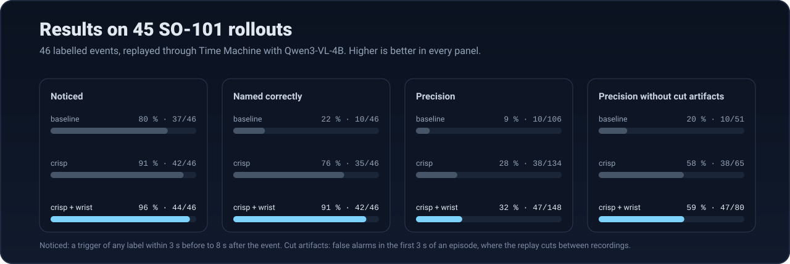
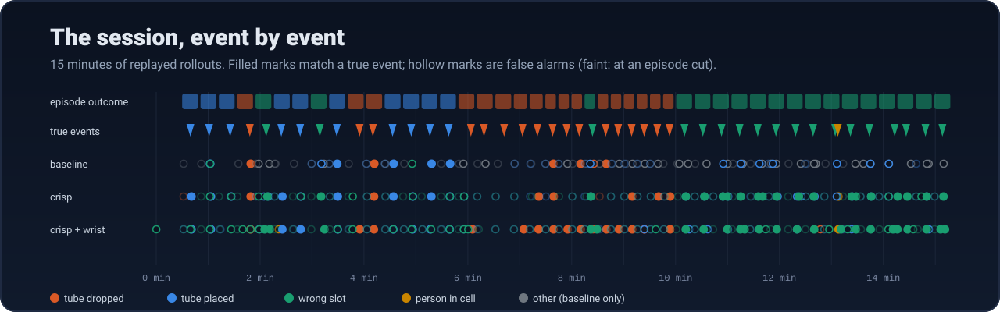
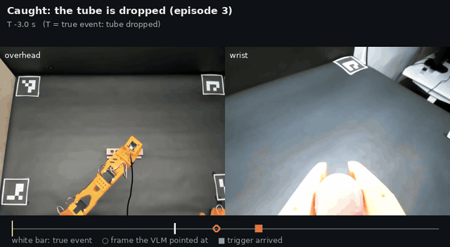
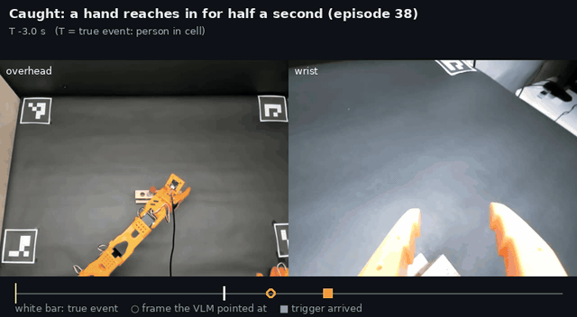
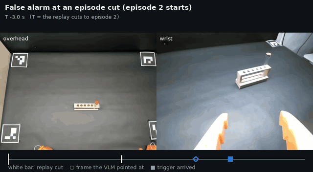
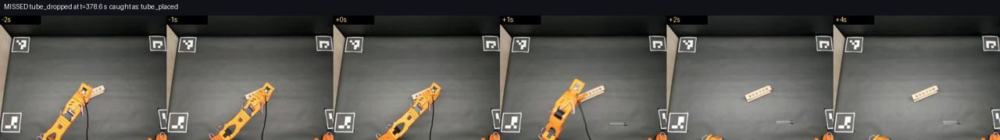
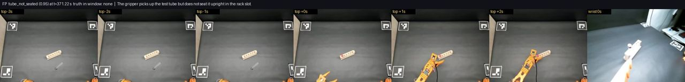

# Results: semantic triggers on 45 SO-101 policy rollouts

We replayed 45 recorded Diffusion Policy rollouts of an SO-101 test-tube task through ROS
Time Machine, as if the robot were running, with Qwen3-VL-4B watching the cameras. We then
scored every trigger against hand labels. With a clear trigger list and both cameras, a
trigger fired within seconds of **44 of 46** real events, and **42** got the right name.
Precision is the open problem.

These are recorded rollouts replayed with [`lerobot-rewind`](../tools/lerobot-rewind/), not
a live robot; [Limits](#limits) lists what that changes.

<p align="center">
  
</p>

- [What was tested](#what-was-tested)
- [Results](#results)
- [What happened](#what-happened)
- [What we learned](#what-we-learned)
- [Limits](#limits)
- [Reproduce it](#reproduce-it)

## What was tested

| | |
|---|---|
| **Robot and task** | LeRobot SO-101, "Pick the tube from the leftmost slot and place it into the rightmost slot" |
| **Data** | 45 Diffusion Policy rollouts (`arpitg1304/rollout_diffpo_jun8_20260608_232637`), overhead and wrist cameras at 640×480, 30 fps. Episodes 15–29 have the rack rotated, and most of them end with the tube dropped |
| **Replay** | One 15-minute session from [`lerobot-rewind`](../tools/lerobot-rewind/): a 30 s idle lead-in, then the episodes 3 s apart, played with `ros2 bag play --clock` |
| **Detector** | Qwen3-VL-4B FP8 on vLLM ([deploy kit](../deploy/vllm/README.md)), RTX 4070 Ti SUPER, 1 Hz sampling, 4 frames per camera per call |
| **Ground truth** | 46 events, labelled by eye from the overhead camera and timed at the gripper's last release (`lerobot-rewind events`): 17 drops, 10 correct placements, 18 tubes left in the wrong slot, and 1 hand reaching in for about half a second |

Three runs used the same replay. They differ only in the watch list:

| Run | Triggers | Cameras watched |
|---|---|---|
| `baseline` | 7: drop, not seated, wrong slot, rack disturbed, empty grasp, person, placed | overhead |
| `crisp` | 4 that don't overlap: [drop, wrong slot, person, placed](../examples/so101_test_tubes/watch_list.yaml) | overhead |
| `crisp + wrist` | the same 4 | overhead + wrist |

## Results

| Run | Noticed | Named correctly | Precision | Precision without cut artifacts | Clips | VLM call |
|---|---|---|---|---|---|---|
| `baseline` | 37/46 (80 %) | 10/46 (22 %) | 10/106 (9 %) | 10/51 (20 %) | 106 | not logged |
| `crisp` | 42/46 (91 %) | 35/46 (76 %) | 38/134 (28 %) | 38/65 (58 %) | 134 | 0.39 s |
| **`crisp + wrist`** | **44/46 (96 %)** | **42/46 (91 %)** | **47/148 (32 %)** | **47/80 (59 %)** | 148 | 0.56 s |

- **Noticed:** a trigger of any label pointed at a frame from 3 s before to 8 s after the
  true event.
- **Named correctly:** the same, with the right label.
- **Precision:** clips whose trigger matches a true event that way.
- **Cut artifacts:** false alarms in the first 3 s of an episode, where the replay cuts from
  one recording to the next (see [Limits](#limits)).

`review eval` reports all of these (`noticed`, `recall_near`, `precision_near`), plus the
looser clip-window recall, which was 39/46 for `crisp + wrist`.

By trigger, for `crisp + wrist`:

| Trigger | True events | Named correctly | Noticed | Clips | Precision (without cuts) | Lag p50 |
|---|---|---|---|---|---|---|
| wrong slot | 18 | 18 | 18 | 85 | 27 % (52 %) | 1.7 s |
| tube dropped | 17 | 14 | 15 | 16 | 88 % (88 %) | 1.0 s |
| tube placed | 10 | 9 | 10 | 45 | 20 % (50 %) | 1.1 s |
| person in cell | 1 | 1 | 1 | 2 | 50 % (50 %) | 0.7 s |

Lag is the time from the true event to the frame the trigger pointed at. The trigger itself
usually arrived under a second after that (a few took 2–3 s), and every clip but one of 148
still had its full 6 s of pre-event data.

## What happened

<p align="center">
  
</p>

**A drop, caught and named.** The gripper opens away from the rack and the tube falls. The
VLM points at the frame 0.8 s after the release: *"The test tube falls from the gripper onto
the table."*

<p align="center"></p>

**A hand, in view for half a second.** Sampling at 1 Hz still caught it: *"A person's hand
enters the frame and touches the test tube rack."*

<p align="center"></p>

**A false alarm caused by the replay.** At an episode cut, the tube jumps from the end of one
recording to the start of the next, and the VLM's window spans the jump.

<p align="center"></p>

**A miss.** Beside the rotated rack, this drop got no trigger of its own; a false "tube placed"
13 s later, at the next episode cut, happened to keep it.

<p align="center"></p>

**What overlapping triggers looked like.** In the baseline, the tube left on the table from the
previous episode was reported as `tube_not_seated`, one of three triggers that fit a drop.

<p align="center"></p>

## What we learned

1. **Write triggers that don't overlap, and only for events that can happen.** The baseline
   list had three triggers that fit a falling tube, and two that never occur in this task
   (31 false alarms between them). Rewriting it as four distinct events took right-label
   recall from 22 % to 76 % with the same model and camera.
2. **Watch the wrist camera when a fixture position matters.** Its close-up of the rack took
   correctly named drops from 7 to 14 of 17. Each call took 0.56 s instead of 0.39 s, still
   inside 1 Hz sampling.
3. **Slot position is the hard part.** From overhead the rack is about 70 pixels wide. Most
   remaining naming errors are placed versus wrong slot.
4. **Fast events are fine at 1 Hz.** The half-second hand was caught in both crisp runs.
5. **Detector latency costs no data.** Triggers point 1–1.7 s after the real event, well
   inside the pre-event window, because Time Machine cuts the clip around that frame rather
   than around the moment the model answered.

## Limits

- **Replay, not a live robot.** The replay holds the last frame between episodes, then cuts
  to the next one. About 70 % of the false alarms fire in the first 3 s of an episode, and a
  real robot, which resets in view, doesn't have those cuts. It has people putting things
  back, though, which can look like events too.
- **One task, one policy, one model.** Results for other tasks, cameras and models will
  differ; this setup gives the measuring stick, not a guarantee.
- **One labeller.** Outcomes were judged by eye from the overhead camera; timings come from
  the joint data.
- **Precision is low.** About one clip in three matches a true event, or three in five
  without the replay artifact. With recall first, extra clips cost disk and review time, not
  data, but they add up.
- **The rollout dataset isn't public yet**, so the commands below need access to it. They
  work the same on any LeRobot dataset you label.

## Reproduce it

```bash
pip install ./tools/lerobot-rewind
lerobot-rewind convert arpitg1304/rollout_diffpo_jun8_20260608_232637 session.mcap \
    --labels examples/so101_test_tubes/labels_rollout_diffpo_jun8.csv      # writes session_truth.csv

(cd deploy/vllm && ./serve.sh)                                              # Qwen3-VL-4B FP8
ros2 launch ros_time_machine time_machine.launch.py use_sim_time:=true \
    config_file:=examples/so101_test_tubes/time_machine.yaml
ros2 launch rtm_watcher watcher.launch.py use_sim_time:=true \
    watch_list:=examples/so101_test_tubes/watch_list.yaml
ros2 bag play session.mcap --clock                                          # 15 min

ros2 run rtm_watcher review eval /tmp/ros_time_machine/so101 --truth session_truth.csv
```
