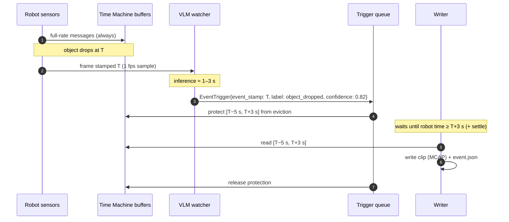
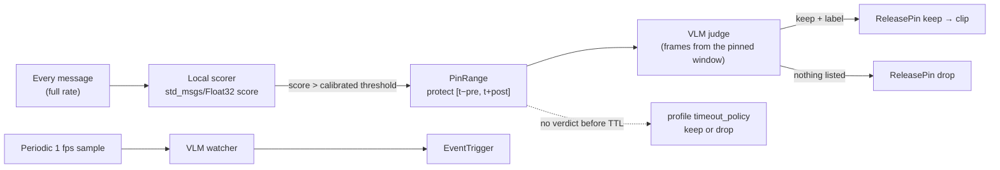

# Semantic triggers (v2)

> Describe the moments you care about in plain English. A vision-language model (VLM)
> watches a low-rate copy of the cameras and fires **time-addressed** triggers; Time
> Machine saves full-rate, multi-topic clips that include the seconds *before* the event,
> each with an `event.json` explaining why it was saved.

This page covers what v2 adds on top of the rule triggers in the [README](../README.md).
Existing v1 configs and the `/emergency_stop`-style rule triggers keep working unchanged.

- [The idea: triggers name a time](#the-idea-triggers-name-a-time)
- [Try it without a GPU](#try-it-without-a-gpu)
- [Run it with a real VLM](#run-it-with-a-real-vlm)
- [Time Machine config](#time-machine-config)
- [Watch list](#watch-list)
- [Pin, then judge: the cascade](#pin-then-judge-the-cascade)
- [Interfaces](#interfaces)
- [event.json](#eventjson)
- [Reviewing clips](#reviewing-clips)
- [Sizing the buffer](#sizing-the-buffer)
- [Failure behavior](#failure-behavior)
- [Status and what's next](#status-and-whats-next)

## The idea: triggers name a time

A v1 trigger meant "save around *now*". A VLM is slow: by the time it has looked at a
frame from time `T` and answered, it is `T + 3 s`. Saving around "now" would cut off the
part you wanted.

In v2 every trigger carries `event_stamp = T` in robot ROS time, and optionally an explicit
`[start, end]`. Time Machine waits until robot time passes `end`, then cuts the window
out of its buffers. Detector latency becomes a buffer-sizing problem instead of a
correctness problem.



Rule triggers, the `~/trigger_snapshot` service, the REST bridge, the VLM watcher and
scorer pins all go through the same queue. It merges overlapping windows of the same
profile into one clip and enforces per-profile rate limits and a global clips-per-hour
budget.

## Try it without a GPU

The demo launch runs fake sensors, a scripted OpenAI-compatible "VLM" that reports
`object_dropped` every few calls, Time Machine and the watcher:

```bash
colcon build --packages-select ros_time_machine_msgs ros_time_machine rtm_watcher
source install/setup.bash
ros2 launch rtm_watcher demo.launch.py          # every:=5 delay:=1.5 by default

# In another terminal, after ~15 s:
ros2 run rtm_watcher review list /tmp/ros_time_machine/demo
cat /tmp/ros_time_machine/demo/object_dropped_*/event.json
```

Each clip holds the 5 s before and 3 s after the frame the fake VLM pointed at, and its
`detection_lag_s` is roughly the fake inference delay.

## Run it with a real VLM

The quickest path is the optional `rtm_vlm` package. It picks a model that fits the device,
starts it, and launches Time Machine and the watcher with it:

```bash
ros2 launch rtm_vlm semantic_stack.launch.py
```

[Choosing and running a VLM](VLM_BACKENDS.md) covers model choice per device, hosted
providers, measured latencies and `vlm bench`. For an NVIDIA GPU machine on the LAN, the
[vLLM kit](../deploy/vllm/README.md) is a two-command setup. To wire it up by hand, any OpenAI-compatible
server works. For example, Qwen3-VL-4B on the robot's GPU or a LAN box:

```bash
vllm serve Qwen/Qwen3-VL-4B-Instruct --max-model-len 8192 --port 8000
# or: llama-server -m qwen3-vl-4b.gguf --mmproj mmproj.gguf --port 8000
# or: ollama serve  (endpoint http://localhost:11434/v1)
```

```bash
ros2 launch ros_time_machine time_machine.launch.py \
  config_file:=$(ros2 pkg prefix ros_time_machine)/share/ros_time_machine/config/semantic_triggers.yaml
ros2 launch rtm_watcher watcher.launch.py watch_list:=/path/to/watch_list.yaml
```

The watcher logs every trigger with how long after the event it was detected:

```
EventTrigger object_dropped (0.82) -> manipulation: "Blue box slips from the gripper." [detected 2.4s after it happened]
```

Its counters (calls, errors, invalid JSON, cooldown suppressions, mean latency) are on
`/rtm_watcher/status` every 5 s.

## Time Machine config

A snapshot is now a **profile**: which topics, how far around the event, and where to
write. The `trigger` block is optional. A profile without one only fires from
EventTrigger messages, pins, or the service.

```yaml
snapshots:
  - name: "manipulation"              # no trigger: fired by the watcher
    recording:
      topics: ["/camera/front/image_raw/compressed", "/joint_states"]
      pre_event_duration: 5.0
      post_event_duration: 3.0
    pins:
      timeout_policy: "drop"          # undecided pin -> no clip ("keep" for safety)
      default_ttl: 20.0
    output:
      name_pattern: "{label}_{timestamp}"   # {label} is new

global:
  event_trigger_topic: "/time_machine/event_trigger"
  max_trigger_latency: 7.0            # extra buffer seconds for slow detectors
  write_settle_time: 0.2              # wait past window end for in-flight messages
  pin_budget_fraction: 0.25           # share of each buffer pins may hold past eviction
  budget:
    max_clips_per_hour: 120           # 0 = unlimited
    merge_gap: 1.0                    # merge windows closer than this (s)
    max_clip_duration: 120            # never grow a merged clip past this (s)
  robot:                              # copied into every event.json
    id: "so101-01"
    policy_version: "act-v3"
```

All new keys are optional and default to v1 behavior. Two behavior changes are worth
knowing about:

- **Overlapping triggers of one profile now produce one clip**, with every event listed
  in `event.json`. v1 wrote one bag per trigger, often with mostly the same data.
- **`output.format: sqlite3` now works.** v1 accepted it in validation but always wrote MCAP.
- **`~/trigger_snapshot` returns an empty `output_path`.** The clip is named after its event
  and written once its window closes, so the path is reported on `~/recording_status`.

The full annotated example is
[`config/semantic_triggers.yaml`](../src/ros_time_machine/config/semantic_triggers.yaml).

## Watch list

The watcher reads a YAML watch list. Full example:
[`watch_list.example.yaml`](../src/rtm_watcher/config/watch_list.example.yaml).

```yaml
watcher:
  endpoint: http://localhost:8000/v1
  model: qwen3-vl-4b-instruct
  cameras: [/camera/front/image_raw/compressed]   # CompressedImage or Image
  sample_hz: 1.0
  context_frames: 4                               # per camera
  state_topics: [/joint_states, /gripper/state]   # summarized as text
  robot_context: "An SO-101 arm picks a red cup and places it on a coaster."
  min_confidence: 0.6
  cooldown_s: 10                                  # per label, in robot time
  events:
    - label: object_dropped
      describe: "An object falls out of the gripper or off the table."
      profile: manipulation
    - label: task_success
      describe: "The cup is placed upright on the coaster."
      profile: episodes
      sample_rate: 0.2                            # keep 20%
      pre_event: 20.0                             # override the profile window
      post_event: 2.0
```

How a detection becomes a trigger:

1. Each camera is sampled at `sample_hz` **in robot time**, so bag replay and sim time
   behave. Frames are downscaled to `max_image_px` (OpenCV or Pillow, if installed).
2. Once there is a new frame, the VLM gets the last `context_frames` frames per camera,
   numbered and time-stamped, plus the state summary and the event list. It is asked for
   `{"events": [{"label", "frame_index", "confidence", "description"}]}` and nothing else.
3. The answer is validated. Fenced or chatty JSON is tolerated, and unknown labels,
   out-of-range indexes and garbage are dropped and counted. A bad answer never crashes
   the watcher.
4. `frame_index` maps back to that frame's robot timestamp, which becomes `event_stamp`.
5. `min_confidence`, then the per-label `cooldown_s`, then `sample_rate` apply.
   Consecutive windows overlap, so the cooldown is what stops one drop from being
   reported four times. A sampled-out event still starts a cooldown, so the next window
   can't re-roll it.

`source_version` records the model and a hash of the prompt and watch list
(`prompt:3f9a1c;model:qwen3-vl-4b-instruct`), so you can tell which wording produced
which clips.

**Privacy:** an endpoint that isn't on this machine or a private LAN is refused unless you
set `allow_remote: true`. API keys come from the environment variable named in
`api_key_env`, never from the file.

## Pin, then judge: the cascade

Sampling at 1 fps misses fast contact events, and a VLM is too slow to run on every
frame. The cascade combines both: cheap local scorers run on everything and **pin** a
window the moment something looks off. The VLM then **judges** only the pinned windows.



```yaml
watcher:
  history_s: 30          # sampled frames kept for judging
  judge_frames: 8
  scorers:
    - topic: /effort_scorer/score
      profile: manipulation
      calibration_s: 60  # first minute of normal operation
      alpha: 0.005       # target false-pin rate per score sample
      pre_event: 5.0
      post_event: 3.0
      ttl_s: 20
```

- **Any scorer works** if it publishes a `std_msgs/Float32` or `Float64` score where
  higher means more unusual: FIPER, FAIL-Detect, policy uncertainty, OOD scores. The
  package ships `effort_scorer` (sudden joint-effort changes from `/joint_states`).
- **Thresholds are calibrated, not hand-tuned.** For the first `calibration_s` seconds
  the watcher collects scores, then sets the split-conformal quantile. During normal
  operation, a new score exceeds it with probability ≤ `alpha`, whatever the scorer's
  scale. Set `threshold:` to use a fixed value instead.
- **The judge prompt says a sensor flagged the window.** Confidence thresholds apply, but
  cooldown and sampling don't, because the scorer already decided the window is unusual.
- **If the VLM is down, nothing is lost.** The pin resolves by the profile's
  `pins.timeout_policy`: `keep` for safety profiles, `drop` for curiosity profiles.

Pins cost memory only while they're pending. A protected message that the ring would
evict moves to a side store capped at `pin_budget_fraction` of the buffer. When that
store is full, the oldest protected messages go first. `BufferStats` reports
`pinned_message_count` and `active_pins`.

## Interfaces

All new interfaces live in `ros_time_machine_msgs`. Service and stats names are relative
to the node (`/time_machine/...` with the bundled launch file).

| Name | Type | Purpose |
|---|---|---|
| `/time_machine/event_trigger` | `msg/EventTrigger` (sub) | Time-addressed trigger from any detector |
| `~/trigger_snapshot` | `srv/TriggerSnapshot` | v1 manual trigger; treated as an event at "now" |
| `~/pin_range` | `srv/PinRange` | Protect `[start, end]` until a decision or TTL; returns `pin_id`, `clamped_start` |
| `~/release_pin` | `srv/ReleasePin` | `keep: true` turns the pin into a clip (with label/description); `false` drops it |
| `~/list_snapshots` | `srv/ListSnapshots` | Configured profiles |
| `~/get_status` | `srv/GetStatus` | Pending clips, pins, written/failed counts |
| `~/buffer_stats` | `msg/BufferStats` (pub) | Per-topic buffer health, including pins |
| `~/recording_status` | `msg/RecordingStatus` (pub) | One message per finished clip, with its path |

```bash
# Save the window around something that happened 4 s ago
ros2 topic pub --once /time_machine/event_trigger ros_time_machine_msgs/msg/EventTrigger \
  "{event_stamp: {sec: $(($(date +%s) - 4))}, profile: manipulation, label: near_miss,
    source: human, confidence: 1.0}"

# Same over HTTP (REST bridge)
curl -X POST http://localhost:8080/api/events -H "Content-Type: application/json" \
     -d '{"label": "near_miss", "seconds_ago": 4, "profile": "manipulation"}'

# Pin, decide later
ros2 service call /time_machine/pin_range ros_time_machine_msgs/srv/PinRange \
  "{start: {sec: $(($(date +%s) - 5))}, profile: manipulation, ttl_seconds: 30, reason: 'operator unsure'}"
ros2 service call /time_machine/release_pin ros_time_machine_msgs/srv/ReleasePin \
  "{pin_id: 1, keep: true, label: grasp_slip, source: human}"
```

In `EventTrigger`, zero `start`/`end` mean `event_stamp ∓` the profile's pre/post
durations. An empty `profile` means the first configured snapshot. A zero `event_stamp`
means the time the trigger arrived.

## event.json

Every clip directory gets a sidecar next to its bag files:

```json
{
  "schema": "rtm.event/1",
  "clip": "object_dropped_1791944103_412000000",
  "profile": "manipulation",
  "storage": "mcap",
  "time_source": "ros",
  "event_stamp": "2026-10-14T02:15:03.412Z",
  "window": { "start": "2026-10-14T02:14:58.412Z", "end": "2026-10-14T02:15:06.412Z", "start_ns": 1791944098412000000, "end_ns": 1791944106412000000 },
  "full_rate_from": "2026-10-14T02:14:58.432Z",
  "coverage": { "start": "2026-10-14T02:14:58.432Z", "end": "2026-10-14T02:15:06.402Z", "pre_event_complete": true },
  "trigger": {
    "label": "object_dropped",
    "description": "Blue box slips from the gripper.",
    "confidence": 0.82,
    "source": "vlm:qwen3-vl-4b-instruct",
    "source_version": "prompt:3f9a1c;model:qwen3-vl-4b-instruct",
    "tags": [],
    "event_stamp": "2026-10-14T02:15:03.412Z",
    "received_at": "2026-10-14T02:15:05.812Z",
    "detection_lag_s": 2.4,
    "merged_from": 1
  },
  "events": [ "... every trigger merged into this clip ..." ],
  "robot": { "id": "pip-01", "policy_version": "diffusion-v12" },
  "topics": [
    {"name": "/camera/front/image_raw/compressed", "type": "sensor_msgs/msg/CompressedImage", "messages": 240, "pre_event_complete": true}
  ],
  "written_at": "2026-10-14T02:15:07.412Z",
  "review": null
}
```

- `trigger` is the highest-confidence merged event; `events` lists all of them.
- `pre_event_complete` is false when a topic's buffer no longer reached back to the
  window start. That means the buffer is too small for your detector's lag: raise
  `max_trigger_latency`.
- `detection_lag_s` is trigger arrival minus event time: the number to watch when
  choosing a model, a sampling rate or where to run inference.
- Timestamps are robot ROS time. With `use_sim_time` (`"time_source": "sim"`) they're
  sim seconds, so the `_ns` fields are the ones to trust.

## Reviewing clips

`review` is a small CLI with no ROS dependency (`python3 -m rtm_watcher.review` works
on any machine with the clips):

```bash
ros2 run rtm_watcher review list  /tmp/ros_time_machine/clips --unreviewed
ros2 run rtm_watcher review mark  /tmp/ros_time_machine/clips/object_dropped_1791944103_412000000 good
ros2 run rtm_watcher review mark  /tmp/ros_time_machine/clips/wrong_object_* bad --note "it was the red cup"
ros2 run rtm_watcher review stats /tmp/ros_time_machine/clips
```

Example output:

```
label           clips  reviewed  precision  lag_p50  lag_max  pre_short  min_conf@0.8
object_dropped  14     12        0.92       2.3      4.1      0          0.70
wrong_object    9      9         0.44       2.6      3.0      0          0.88
```

Verdicts are written into `event.json` (`review`), so they travel with the clip.
`min_conf@0.8` is the lowest confidence cutoff at which that label's reviewed clips reach
80 % precision. It's a data-driven starting point for each event's `min_confidence`.

To compare trigger strategies (rules only, scorers only, VLM only, full cascade; model
sizes; sampling rates), replay the same labelled bags through each setup with
`use_sim_time` and score every output directory against the same ground truth:

```bash
# labels.csv: label,time_s   (robot/bag time of each hand-labelled event start)
ros2 run rtm_watcher review eval /tmp/run_4b_1fps --truth labels.csv
```

`eval` reports recall (labelled events inside a saved clip), precision (clips containing a
labelled event), detection lag p50/p99 and pre-event coverage. `--any-label` counts a hit
regardless of the label the clip fired with.

## Sizing the buffer

```
buffer seconds ≥ pre_event_duration + post_event_duration + max_trigger_latency
```

| Lag component | Rough range |
|---|---|
| Sampling (1 fps) | 0–1 s |
| VLM context (frames before the event it needs to see) | 2–4 s |
| Network (LAN vs cloud) | 0.02–0.3 s |
| Queue + inference (4B VLM, few images, short JSON) | 0.3–2 s |
| **Total detection lag** | **~3–7 s** |

Measure yours: `review stats` shows `lag_p50` and `lag_max` per label, and the watcher's
status topic shows mean inference latency. Set `max_trigger_latency` a little above the
worst lag you see.

Compressed image topics are far cheaper to buffer than raw ones: 15 s of 640×480 RGB at
30 fps is ~420 MB raw versus ~15–30 MB as JPEG. Buffer the `.../compressed` topics where
you can.

## Failure behavior

| Situation | Behavior |
|---|---|
| VLM unreachable | Watcher logs (throttled), backs off 1 s, keeps sampling. Rule triggers are unaffected; pins resolve by TTL policy |
| VLM returns invalid JSON or unknown labels | Dropped and counted in `/rtm_watcher/status`; never crashes |
| Same event reported repeatedly | Per-label cooldown in the watcher, plus merging of overlapping windows in Time Machine |
| Trigger storm | Per-profile `max_triggers_per_minute` and global `max_clips_per_hour`; rejected triggers are logged |
| Trigger arrives later than the buffer reaches | The clip is still written with what's left; `pre_event_complete: false` |
| Robot time jumps backwards (bag loop) | Pending clips are written immediately; the watcher clears its frame context |
| Shutdown with clips pending | Written with whatever data exists before the node exits |
| Endpoint outside the LAN | Refused unless `allow_remote: true` |

## Status and what's next

Implemented so far, mapped to the v2 plan:

| Plan item | Status |
|---|---|
| Phase 0: `sqlite3` storage bug | Fixed |
| Phase 0: ROS clock everywhere | Buffers already used the node clock; the writer now waits on robot time instead of sleeping on the wall clock, and the explicit-`now` `getRecent` overload makes sim-time stamps queryable |
| Phase 0: `EventTrigger`, old service routed through it | Done |
| Phase 0: `event.json` sidecar | Done (MCAP metadata records: not yet) |
| Phase 0: compressed ingest | Not yet (buffer `.../compressed` topics instead) |
| Phase 1: `PinRange` / `ReleasePin`, TTL, pin budget | Done |
| Phase 1: warm tier on disk | Not yet |
| Phase 2: watcher, prompt builder, client, validation, cooldowns | Done, plus a fake VLM, a no-GPU demo and `quickstart` (configs generated from your topics) |
| Phase 2: latency benchmark | Done: `vlm bench` and `deploy/vllm/check.sh`; Qwen3-VL-4B FP8 on an RTX 4070 Ti SUPER answers in 0.23 s (warm p50) |
| Phase 3: scorer contract, conformal calibration, effort scorer | Done; frame-difference scorer and random baseline clips not yet |
| Phase 4: review loop, precision per label | Done as a CLI (no web UI yet) |
| Evaluation metrics (recall, precision, lag, pre-event coverage) | `review eval`, including `noticed`, `recall_near` and `precision_near` (scored at the frame each trigger pointed at) |
| Evaluation on real robot data | Done on 45 replayed SO-101 policy rollouts: 44/46 events noticed, 42/46 named correctly, 32 % precision ([results](RESULTS_SO101.md)); a live-robot run is next |
| Replaying LeRobot datasets | Done: [`lerobot-rewind`](../tools/lerobot-rewind/) writes any v2.1/v3.0 dataset as a ROS 2 MCAP session |
| LeRobot live bridge (cameras and joints from inside LeRobot) | Not yet |
| Clearing the watcher's window at episode resets | Not yet: most replay false alarms come from episode cuts |
| Phase 4: distillation, LeRobot exporter | Not yet |
